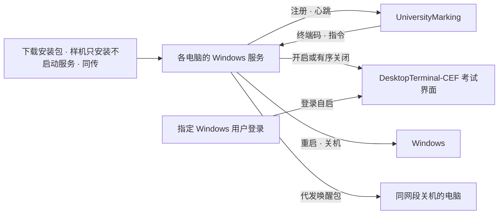

# 考场终端批量下发与开机注册方案

学校先确定 UniversityMarking 服务器，下载安装考试端到一台样机，再用机房现有工具同传。每台电脑上的 Windows 服务随系统启动，自动向学校服务器注册。管理员在「基础信息维护 → 考场维护」用「下载考试端」下载带本校配置的安装包，装到一台样机，再用「绑定终端」把注册上来的电脑批量绑定到座位，之后按考场或座位批量开启、关闭考试端，开机、重启或关机。`DesktopTerminal-CEF` 继续负责登录 Windows 后的考试界面。

## 1. 现有项目与实施入口

DesktopTerminal-CEF 源码基线为 `d5172d3`，UniversityMarking 源码基线为 `b441efe3`。

| 能力 | 当前源码 | 实施入口 |
|---|---|---|
| 安装分发 | 已有 x64、x86 NSIS EXE，需要管理员权限。API 地址、考试网址等交互配置来自自定义页面。 | 复用原 EXE：读取同目录的 `school-config.ini` 预填配置页，增加样机安装模式（只安装、不启动服务）。样机安装后验证考试端可访问学校服务器，再做同传。 [安装入口](../installer.nsi#L43) · [配置页面](../installer.nsi#L128) · [配置写入](../installer.nsi#L414) |
| 开机自启与界面 | 主入口创建 `QApplication`，Windows manifest 要求管理员权限，代码还有 UAC 提权检查。安装器创建快捷方式。 | 新建 Windows 服务负责登录前注册和心跳。考试界面由机房登录策略或为指定考试账户预配置的登录任务启动。当前提权方式需在该账户和现场 Windows 策略下验收。 [主入口](../src/main.cpp#L190) · [权限声明](../cmake/app.manifest.in#L11) · [快捷方式](../installer.nsi#L502) |
| 请求固定地址 | `ConfigManager` 读取程序目录下的配置和 INI 覆盖。`DesktopAuthManager` 已能向配置的地址发 JSON 请求。 | 安装器按 `school-config.ini` 写入独立的终端管理地址。复用 Qt Network 的请求和日志写法，终端管理连接独立于 CEF 和现有考试认证。 [配置路径](../src/config/config_manager.cpp#L29) · [请求](../src/network/desktop_auth_manager.cpp#L294) · [地址优先级](../src/network/desktop_auth_manager.cpp#L411) |
| 座位与网段 | UniversityMarking 已有物理考场 `TD_KDXX`（网段 `KCIP`、总行数、总列数）和座位 `TD_KDZW`（行列、状态、IP 地址 `IPDZ`、设备编码 `SBBM`）。`IPDZ`、`SBBM` 目前页面未使用。 | 绑定写入 `SBBM`（12 位终端码）和 `IPDZ`（终端来源 IP），不新增数据库表。 |
| 终端控制 | 当前 CEF 启动流程触发考试认证。`Application::shutdown()` 提供浏览器、键盘拦截和窗口的清理逻辑。manifest 为 `requireAdministrator`，F10 退出要输入 `exitPassword`，没有单实例机制。 | Windows 服务通过心跳领取指令，在考试账户会话启动 CEF、经本机管道有序关闭 CEF，执行重启和关机，并为同网段关机的电脑代发唤醒包。 [启动认证](../src/core/application.cpp#L135) · [关闭逻辑](../src/core/application.cpp#L250) |

## 2. 首装与机房同传

1. 学校确定服务器后，管理员在考场维护工具栏点「下载考试端」，选 64 位或 32 位，得到压缩包。压缩包里是原样的签名安装程序和 `school-config.ini`，配置文件由服务端按当前实例生成，写明终端管理地址、学校实例号和考试入口，考试入口取系统参数「学生端访问地址」（在线考试分组），下载前先在系统参数里填好含协议和路径的完整地址。安装程序由发布流程放在服务器上与帮助中心共用的 `tool` 目录（`system.file-profile` 下的 `tool`），文件名固定为 `DesktopTerminal-setup-x64.exe`、`DesktopTerminal-setup-x86.exe`。
2. 管理员解压后在一台样机上运行安装程序，勾选「样机模式」。安装程序读取同目录的 `school-config.ini` 预填配置页，管理员不需要输入地址，直接点下一步。样机模式只安装并把服务注册为随系统启动，不启动服务，也不生成注册令牌。确认 CEF 能打开考试入口后，直接制作母盘，不要在样机上运行服务；已经运行过服务的样机，先停服务并删除 `%ProgramData%\UMTerminal\state.json`。
3. 同传母盘包含考试端、Windows 服务和 `school-config.ini` 写成的服务配置。母盘里没有注册令牌和终端码，它们在同传后各台电脑首次启动、服务启动时才生成。
4. 同传完成后各台电脑开机，自动注册。管理员在考场维护工具栏看到「绑定终端（N）」，N 就是已注册但还没绑定的电脑数。

单机补装使用同一个压缩包，不勾选样机模式，安装后服务立即启动并注册。服务的配置、注册令牌和终端码存放在 `%ProgramData%` 下的受限目录，升级时保留。学校已有 AD 或机房管理平台时，也可用 NSIS `/S` 下发补装和升级，参数 `/TERMINAL_URL=`、`/SLID=`、`/EXAM_ACCOUNT=` 优先于 `school-config.ini`，无人值守入口需处理覆盖安装、运行库、安装日志和失败退出码。 [NSIS 静默安装](https://nsis.sourceforge.io/Reference/SilentInstall) · [NSIS MessageBox](https://nsis.sourceforge.io/Reference/MessageBox)

## 3. 谁负责什么

| 能力 | 实现方式 | 前提和结果判定 |
|---|---|---|
| 开机后自动注册 | 安装器注册独立 Windows 服务，使用 SCM 自动启动和恢复策略。目标进程在 `CMakeLists.txt` 新增，使用 C++17、Qt Core/Network 和 Windows 服务 API，不依赖 CEF。 | 无人登录也能注册和发心跳。服务账号只授予所需权限。 |
| 登录后自动打开考试端 | 机房登录策略或登录触发任务，在指定 Windows 用户的交互会话打开现有 CEF 客户端。安装器用管理员权限预配置任务。 | 当前 CEF 要求管理员权限，需验证登录任务、用户令牌和 UAC 行为。如果考试账户必须是标准用户，需要调整前台权限设计。 |
| 开启考试端 | 管理员按考场或座位批量下发。服务用 `WTSGetActiveConsoleSessionId` 找到控制台会话，确认登录的是指定考试账户后，用 `WTSQueryUserToken` + `CreateProcessAsUser` 在该会话启动 CEF。 | Windows 未登录考试账户时回报原因。CEF 新增命名互斥体，与登录自启撞上时只保留一个窗口。考试账户是开启 UAC 的管理员时，服务取会话令牌关联的完整令牌启动；考试账户是普通用户时启动失败并回报需要管理员权限，此时需把 CEF 改为普通权限运行、特权动作移到服务，以试点账户策略为准。 |
| 关闭考试端 | CEF 启动后创建只允许 SYSTEM 连接的本机命名管道，服务经管道发送关闭请求，CEF 在主线程调用现有有序退出逻辑。 | 不弹 F10 退出密码框，不强制结束进程。退出后服务继续发心跳并上报考试端未运行。 |
| 重启与关机 | Windows 服务领取指令后先回报已接受，再调用系统电源接口。 | 重启以重新上线的心跳为准；关机后停止心跳，90 秒后显示离线。 |
| 远程开机 | 关机的电脑收不到服务器的消息，唤醒包又是局域网广播、一般不跨路由器，所以由目标所在网段的在线终端代发。服务端按网段挑两台在线终端，下发 `WAKE_RELAY` 和 MAC 列表，代发机向本网段广播地址和 `255.255.255.255` 的 UDP 9 端口各发 3 次魔术包。 | 目标开机后发出心跳即显示在线，3 分钟未上线记为「唤醒已发送，未上线」。需要 BIOS 和网卡开启网络唤醒、Windows 关闭快速启动、电脑未断电，按机型实测。整间机房都关机时没有代发机，需先手动开一台或常开一台已绑定的电脑。 |

指令有开启考试端、关闭考试端、重启、关机、代发唤醒包五种。服务按指令 ID 在本地去重，下发超过 10 分钟的指令不执行。系统不判断考生是否在作答，考试期间的操作由管理员在确认框核对范围和台数后决定。 [Microsoft WoL 说明](https://learn.microsoft.com/en-us/troubleshoot/windows-client/setup-upgrade-and-drivers/wake-on-lan-feature) · [Windows 交互式服务](https://learn.microsoft.com/en-us/windows/win32/services/interactive-services)

## 4. 注册、终端码与心跳

1. Windows 服务首次启动时生成注册令牌（UUID），向终端管理地址提交学校实例标识、注册令牌、计算机名、本机出站 IP 和版本。服务端记录来源 IP。未绑定期间，开机立即注册一次，之后每 5 分钟一次。终端管理地址可以是静态 IP、VIP 或校内域名，支持 `http` 和 `https`。终端码持有即可用，条件允许时使用 `https`；使用 IP 访问 `https` 时，服务证书须含该 IP 的 SAN，终端须信任对应 CA。
2. 管理员完成绑定后，服务端为座位生成 12 位终端码，写入该座位的 `SBBM`，同时把来源 IP 写入 `IPDZ`。终端下一次注册时领取终端码，保存到本地，此后改发心跳。
3. 终端码前 11 位由实例号、座位 ID 和 3 位随机数换算得出，可反解出实例号和座位 ID 的低四位，便于定位和核对；第 12 位是 Luhn 校验位。服务端以「本实例座位的 `SBBM` 与终端码全等」确认身份。每次绑定都会重新生成终端码，解绑或改绑后旧码立即失效。
4. 心跳每 30 秒一次，另加随机抖动，上报终端码、计算机名、本机出站 IP 与前缀长度、有线网卡 MAC、考试端是否运行，以及上一批指令的执行结果。服务端返回该座位的待执行指令。来源 IP 变化时更新 `IPDZ`。MAC 和网段存 Redis，终端离线后仍保留，供远程开机使用，解绑时删除。
5. 终端收到「终端码无效」时清除本地终端码，回到注册流程，重新出现在绑定终端列表里。管理员解绑或电脑被重新同传，都会走这条路径。

一万台每 30 秒一次心跳，平均约 333 次/秒，服务端只读写 Redis。终端码是持有即可用的凭据，条件允许时使用 HTTPS 传输。母盘必须在未绑定状态下制作，否则同传会复制同一个终端码。

## 5. IP 检测与考场识别

### 5.1 研究生机考的现有规则

- 多试题机考在初始化作答和开始考试时调用 `KsBusiness.checkExamFzbIpxz()`。`IpUtil.getIpv4()` 优先从 `X-Forwarded-For` 中取首个可解析的 IPv4，并按请求情况回退到其他代理头或连接对端地址。 [初始化校验](../../Project/UniversityMarking/university-marking/core/src/main/java/com/sdzdf/UniversityMarking/service/stuexam/impl/JkksServiceImpl.java#L435) · [开考校验](../../Project/UniversityMarking/university-marking/core/src/main/java/com/sdzdf/UniversityMarking/service/stuexam/impl/JkksServiceImpl.java#L524) · [请求取址](../../Project/UniversityMarking/university-marking/common/src/main/java/com/sdzdf/UniversityMarking/utility/IpUtil.java#L215)
- 启用固定 IP 时，系统将当前请求地址与考生已记录的 `FZB_IP_KSIP` 比对。启用网段限制时，按考场方式优先用本场 `KSKC.KCIP`，否则用考试配置 `FZB_IP_XZWD`。规则以分号分隔，支持完整 IPv4 和按段匹配的 `*`。 [机考 IP 规则](../../Project/UniversityMarking/university-marking/core/src/main/java/com/sdzdf/UniversityMarking/bussiness/KsBusiness.java#L833) · [通配符匹配](../../Project/UniversityMarking/university-marking/common/src/main/java/com/sdzdf/UniversityMarking/utility/IpUtil.java#L346)

终端注册发生在考生登录之前，按物理考场 `TD_KDXX.KCIP` 匹配，沿用同一套规则格式。考试和场次的 IP 限制继续由机考流程执行。 [物理考场网段](../../Project/UniversityMarking/university-marking/core/src/main/java/com/sdzdf/UniversityMarking/domain/entity/Kdxx.java#L43)

### 5.2 Windows 服务采集本机 IP

用 Windows `GetBestRoute2` 取到终端管理地址的路由所选的本地源地址和接口索引，再用 `GetAdaptersAddresses` 取该接口的 IPv4、前缀长度和 MAC。出站接口不是有线网卡时，另取已启用的物理有线网卡的 MAC 供远程开机使用。排除回环和 `169.254.0.0/16` 自动配置地址。注册和心跳上报这个本机出站 IP，供管理员核对多网卡或 NAT 的情况；考场推荐以服务端看到的来源 IP 为准。现有 `NetworkChecker` 已用 `QNetworkInterface` 枚举活动接口，可参考其写法。 [现有网卡诊断](../src/network/network_checker.cpp#L127) · [GetBestRoute2](https://learn.microsoft.com/en-us/windows/win32/api/netioapi/nf-netioapi-getbestroute2) · [GetAdaptersAddresses](https://learn.microsoft.com/en-us/windows/win32/api/iphlpapi/nf-iphlpapi-getadaptersaddresses)

### 5.3 服务端取来源 IP 与推荐考场

| 接入场景 | 服务端取址 |
|---|---|
| 终端直接访问学校后端 | 使用实际 TCP 对端地址，IPv4 映射的 IPv6 地址归一化为 IPv4。 |
| 经过校内 Nginx 等反向代理 | 只信任明确配置的代理写入的转发头，头缺失或不合法时来源记为未知。 |
| NAT 或正向代理 | 来源 IP 不在任何考场网段内，考场留空，由管理员手动选择。 |

来源 IP 只命中一个启用考场的网段时，绑定终端弹窗预填该考场；未命中或命中多个时留空。例如博雅楼 101 机房配置 `192.168.124.*`，来源为 `192.168.124.37` 且只有它命中，就预填博雅楼 101。两间机房共用网段时，由管理员按现场情况选择。

### 5.4 批量绑定座位

绑定终端弹窗列出全部未绑定终端，默认全选：

1. 需要时用「批量设置考场」把所选终端改到同一个考场。
2. 选择「按 IP 顺序」或「按计算机名顺序」，点「分配座位」。系统按考场分组排序，再按座位的行、列顺序填入状态正常且未绑定的座位。IP 按四段数值比较；计算机名忽略大小写按自然顺序，`PC2` 排在 `PC10` 前。
3. 逐行核对，需要时手改考场或座位，点「确认绑定（n）」。

座位不够或没选考场的终端会提示原因、座位留空，其余终端照常提交。两行选了同一座位或座位已被占用时，整笔拒绝并指出冲突的终端。

## 6. 第一轮验证范围

从至少两个考场选取有代表性的机器型号、Windows 版本和 x86/x64 构建，在授权测试时段验证。

| 验收场景 | 预期结果 |
|---|---|
| 下载考试端安装包 | 压缩包内安装程序与服务器上的文件一致，`school-config.ini` 与当前实例相符；服务器没有对应安装程序时提示原因。 |
| 下载包直接安装 | 运行解压出的安装程序，不要求填写任何地址，装完后电脑出现在绑定终端弹窗中。 |
| 样机只安装不启动服务 | 勾选样机模式安装后，服务已注册为随系统启动但未启动，机器上没有注册令牌和终端码。 |
| 样机同传到多台电脑后开机 | 每台电脑生成不同的注册令牌，绑定终端弹窗中出现对应台数。 |
| 按 IP 和按计算机名分配座位 | 两种顺序生成不同的座位分配，跳过故障、禁用和已绑定座位。 |
| 确认绑定后 | 终端领取终端码改发心跳，考场卡片和座位布局显示在线。 |
| 经 NAT 或两间机房共用网段 | 考场留空，管理员手动选择后可正常绑定。 |
| 勾选多个考场批量开启、关闭考试端 | 确认框列出将执行和跳过的台数，只对可执行的终端下发。 |
| 重启与关机 | 重启后重新上线；关机后 90 秒内显示离线；过期指令不执行。 |
| 远程开机 | 开启网络唤醒、关闭快速启动后，同网段在线终端代发能唤醒关机的电脑；确认框正确列出已在线、未上报 MAC、同网段无在线终端的台数。记录不支持的机型。 |
| 开启与关闭考试端 | 在考试账户会话启动 CEF，未登录时回报原因；远程开启与登录自启只保留一个窗口；关闭不弹退出密码，关闭后服务仍在线。 |
| 解绑或重新同传 | 旧终端码失效，电脑重新出现在绑定终端弹窗中。 |
| 修改已绑定座位的备注 | 设备编码和 IP 地址保持不变。 |

验收记录安装退出码、同传后服务启动时间、来源 IP、本机出站 IP、推荐考场、终端码和指令执行结果。Windows 实机和现场代理路径待机房试点验证。

## 考试端管理员工具箱

在考试端按 F11 并输入考试端密码，进入二级菜单「管理员工具箱」。工具箱每行显示三格。从工具表格选择「设置座号」，进入三级页面，输入座号并保存。本机状态栏立即更新，重启后仍保留。座号按文本保存，例如 `07` 会保留前导零。

「设置座号」页面显示当前座号、来源和操作结果。「返回工具箱」和 Esc 都可返回工具列表。「清除手动座号」会恢复已缓存的后台座号。后台成功下发有效座号时，终端自动采用后台值并清除手动值。终端码失效时，终端清除本机座号。补填只用于本机显示，考场绑定和考生分配以后台记录为准。
